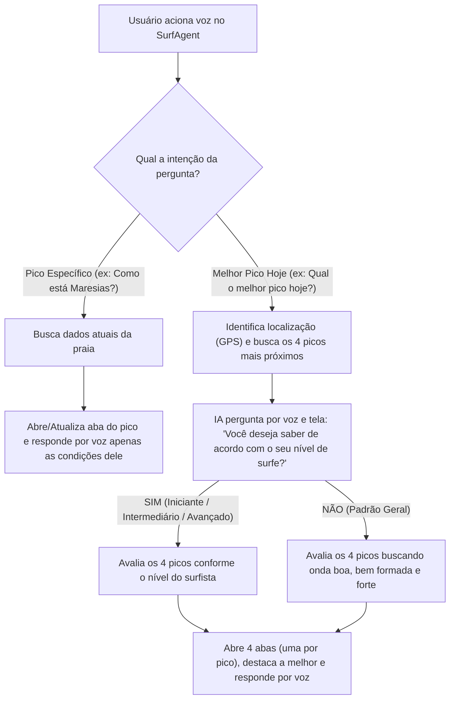

# Product Requirements Document (PRD) — SurfAgent (MVP)

**Product Name:** SurfAgent  
**Author:** Marco  
**Date:** 2026-11-17  
**Version:** 1.1 (MVP)

---

## 1. Resumo Executivo

Surfistas costumam perder tempo navegando por múltiplos gráficos, tabelas complexas e telas em aplicativos tradicionais de previsão de ondas, muitas vezes enquanto estão dirigindo, preparando a prancha ou acordando cedo.

O **SurfAgent** é o MVP de um **aplicativo de surfe leve, simples e prático**, aberto para todas as praias, que funciona **por comando de voz com um Agente de IA** que responde por voz e apresenta simultaneamente todas as informações em tela.

O aplicativo opera em dois modos principais de consulta:
1. **Consulta de praia específica:** O usuário pergunta sobre uma praia específica e o **SurfAgent** apresenta diretamente (por voz e em uma aba dedicada) apenas as informações sobre as condições atuais daquele pico.
2. **Recomendação do melhor pico hoje ("Onde surfar hoje?"):** O usuário pergunta qual o pico com as melhores condições para surfar hoje. O **SurfAgent** identifica a localização do usuário e pergunta: ***"Você deseja saber de acordo com o seu nível de surfe?"***
   - **Se SIM:** A IA avalia os **4 picos mais próximos** e destaca aquele com as melhores condições adequadas ao nível informado pelo surfista (Iniciante, Intermediário ou Avançado).
   - **Se NÃO:** A IA avalia os **4 picos mais próximos** e destaca o lugar que reúne todas as combinações que geram uma **onda boa, bem formada e forte**.

Todos os picos consultados ou recomendados são abertos em **abas distintas**, permitindo avaliação visual rápida, ficando salvos localmente e sendo atualizados automaticamente sempre que o usuário acessar o app para novas consultas.

---

## 2. Visão do Produto & Diferencial Competitivo

### 2.1 Declaração de Visão
Para surfistas em qualquer praia que buscam praticidade antes de cair na água, o **SurfAgent** é um assistente de surfe multimodal (voz + tela) que responde instantaneamente sobre qualquer pico ou recomenda o melhor entre os 4 picos mais próximos — adaptando-se opcionalmente ao nível do surfista — e mantém os picos abertos em abas persistentes e sempre atualizadas.

### 2.2 O Que Torna o SurfAgent Único
1. **Voice-First + Visual Sync:** O usuário pergunta por voz e recebe uma resposta falada objetiva enquanto os dados aparecem organizados na tela.
2. **Aberto para Todas as Praias:** Funciona com qualquer praia consultada pelo nome ou via geolocalização em qualquer litoral.
3. **Filtro Inteligente de Recomendação (Com ou Sem Nível de Surfe):**
   - Na busca pelo melhor pico, pergunta se o usuário quer filtrar pelo seu nível de surfe;
   - Se optar por informar o nível, recomenda a praia ideal para a segurança e evolução daquele perfil;
   - Se optar por não informar, prioriza a combinação clássica de **onda boa, bem formada e forte**.
4. **Consulta Direta sem Fricção para Pico Específico:** Ao perguntar de uma praia específica, vai direto ao ponto e mostra apenas as condições daquela praia, sem perguntas intermediárias.
5. **Abas Persistentes e Auto-Atualizáveis:** Cada pico abre em uma aba própria que fica salva e é atualizada automaticamente toda vez que o usuário abre o app.

---

## 3. Problema a Ser Resolvido

- **Excesso de complexidade visual:** Apps tradicionais exigem abrir várias telas e interpretar dezenas de números para comparar praias próximas.
- **Mãos ocupadas / surfista em movimento:** Dificuldade de digitar e navegar em menus enquanto dirige ou prepara o equipamento.
- **Recomendações genéricas:** Um mar perfeito para um surfista avançado (onda forte e pesada) pode ser inadequado para um iniciante; ao mesmo tempo, muitos surfistas querem apenas saber onde está quebrando a onda mais bem formada e forte do momento.
- **Retrabalho diário:** Ter que buscar novamente as mesmas praias toda vez que abre o aplicativo.

---

## 4. Objetivos do MVP

### 4.1 Objetivos de Produto
- Entregar uma experiência multimodal fluida (Voz + Tela em Abas) com tempo de resposta inferior a 3 segundos.
- Cobrir qualquer praia consultada via API global de previsão marítima e meteorológica.
- Validar a árvore de decisão do Agente de IA (Pico Específico vs. Top 4 Próximos com opção de Nível de Surfe).
- Manter o aplicativo ultraleve, simples e prático de usar.

### 4.2 Objetivos do Usuário
- Consultar rapidamente qualquer praia específica e ver/ouvir suas condições atuais.
- Descobrir qual dos 4 picos mais próximos está melhor hoje — seja para o seu nível de surfe, seja pela melhor combinação de onda boa, bem formada e forte.
- Visualizar os picos em abas separadas que ficam salvas e atualizadas a cada acesso.

---

## 5. Regras de Negócio e Fluxos Conversacionais do Agente de IA



### 5.1 Regra 1 — Consulta de Pico Específico
- **Gatilho:** O usuário pergunta sobre uma praia específica (ex.: *"Como estão as condições em Itamambuca?"* ou *"Como está o mar no Arpoador?"*).
- **Comportamento:**
  - O Agente **não pergunta o nível de surfe**.
  - O sistema busca os dados atuais daquela praia, abre (ou atualiza) uma aba exclusiva para ela e narra por voz o boletim objetivo das condições atuais.

### 5.2 Regra 2 — Consulta do Melhor Pico para Surfar Hoje ("Falar com o SurfAgent")
- **Gatilho:** O usuário clica no botão **"Falar com o SurfAgent"** ou pergunta *"Qual o pico com as melhores condições para surfar hoje?"*.
- **Passo 1 (Geolocalização Inicial e Top 4 Picos Próximos):**
  - O app solicita geolocalização (`navigator.geolocation`).
  - Calcula a distância real em linha reta via **fórmula de Haversine** entre as coordenadas do usuário e a base de picos cadastrados (`SPOTS_DATABASE`).
  - Renderiza automaticamente os **4 picos mais próximos** em formato de abas horizontais no topo da interface.
  - *Fallback:* Caso a permissão seja negada ou indisponível, carrega 4 picos padrão da região e exibe um aviso discreto permitindo ativar a localização posteriormente.
- **Passo 2 (Saudação e Triagem por Voz):**
  - O SurfAgent fala exatamente:
    > *"Você gostaria de saber a previsão de acordo com o seu nível? Se sim, diga qual dos níveis é o seu: avançado, intermediário ou iniciante. Caso não, apenas diga: apenas me traga a praia com as melhores condições."*
  - A interface exibe simultaneamente o balão conversacional e 4 chips rápidos de toque: `🌊 Melhores Condições (Sem Nível)`, `🟢 Iniciante`, `🟡 Intermediário` e `🔴 Avançado`.
- **Passo 3 (Classificação da Intenção via STT):**
  - O sistema classifica a resposta falada ou o toque em uma das 4 intenções:
    - `INTENT_NO_LEVEL`: Melhores condições gerais / Sem filtro de nível (aceita sinônimos como *"não precisa"*, *"sem nível"*, *"tanto faz"*, *"melhores condições"*, *"onda boa e forte"*).
    - `INTENT_BEGINNER`: Iniciante / Básico (aceita *"iniciante"*, *"básico"*, *"começando"*, *"aprendendo"*).
    - `INTENT_INTERMEDIATE`: Intermediário (aceita *"intermediário"*, *"médio"*, *"evolução"*).
    - `INTENT_ADVANCED`: Avançado (aceita *"avançado"*, *"experiente"*, *"pro"*, *"tubo e pressão"*).
  - *Bypass:* Caso o usuário cite diretamente o nome de uma praia durante o diálogo, a IA identifica a intenção de pico específico e abre a praia solicitada sem insistir no filtro de nível.
- **Passo 4 (Matriz de Ranqueamento e Pontuação Ponderada):**
  - O motor `rankSpotsForSurfer` pontua os picos de 0 a 100 com base em critérios técnicos reais:
    - **Altura da onda (30%):** Encaixe exato na faixa de segurança e manobrabilidade de cada perfil.
    - **Vento (30%):** Direção em relação ao quadrante terral do pico (`offshoreWindDeg`) e intensidade em nós ($\le 8\text{ kt}$ para sem nível/vidro, $\le 10\text{ kt}$ para iniciante, $\le 12\text{ kt}$ para intermediário, $\le 14\text{ kt}$ para avançado).
    - **Período e Energia (25%):** Ondulação primária e força do swell em Joules/kJ.
    - **Maré e Fundo (15%):** Compatibilidade com a maré ideal do pico (`bestTide`) e tipo de fundo (`bottomType`: areia para iniciantes vs. laje/coral para avançados).
- **Passo 5 (Contexto de Maré e Fallback Inteligente):**
  - **Contexto de Maré:** Se o pico vencedor estiver fora da maré ideal no momento, mas atingir o ponto ideal nas próximas 2 horas, a fala instrui o surfista sobre o melhor horário para entrar na água.
  - **Fallback Inteligente:** Se nenhum pico atingir score $> 60$ (mar flat ou temporal maral), o SurfAgent seleciona o pico mais abrigado e explica claramente o fator limitante.
- **Passo 6 (Sincronização de UI e Fala):**
  - A aba do pico vencedor é aberta/focada (sendo adicionada à barra caso ainda não estivesse aberta) e recebe o selo `★ MELHOR AGORA`.
  - O SurfAgent sintetiza um resumo objetivo em voz natural explicando os fatores técnicos que motivaram a recomendação.

### 5.3 Regra 3 — Navegação, Adição Dinâmica e Persistência das Abas
- **Navegação Dinâmica:** Ao pesquisar uma nova praia na barra de busca ou por comando de voz, o sistema adiciona o pico como uma **nova aba** junto às abas já abertas (sem duplicatas) e ativa-a imediatamente.
- **Persistência no LocalStorage:** As abas abertas pelo usuário (picos iniciais por proximidade + picos pesquisados) são salvas no `localStorage`.
- **Auto-Atualização ao Reabrir:** Ao retornar ao site, as abas salvas são restauradas na mesma ordem, disparando requisições em tempo real para a API de previsão (Open-Meteo WW3 + GFS) para renovar toda a telemetria e gráficos.

---

## 5.4 Matriz de Calibração Técnica de Leitura de Ondas

| Perfil / Intenção | Altura (`waveHeight`) | Período (`wavePeriod`) | Energia (`energyJoules`) | Vento (`windSpeed` / Direção) | Tipo de Pico / Maré |
| :--- | :--- | :--- | :--- | :--- | :--- |
| **Sem Nível (`INTENT_NO_LEVEL`)** *(Clássico / Melhores condições)* | $\ge 1.0\text{ m}$ *(ou $\ge 0.8\text{ m}$ se período $\ge 12\text{s}$)* | $\ge 10\text{s}$ | $\ge 500\text{ J}$ | **Terral** (*offshore*) ou **Vidro/Fraco** ($\le 8\text{ nós}$) | Bônus alto se a maré atual coincidir com `bestTide` do pico |
| **Iniciante (`INTENT_BEGINNER`)** *(Segurança e onda cheia)* | $0.3\text{ m}$ a $0.6\text{ m}$ | $\le 10\text{s}$ *(evita swells longos de impacto)* | $100\text{ J}$ a $450\text{ J}$ | **Fraco** ($\le 10\text{ nós}$) ou **Terral leve** *(evitar maral moderado/forte)* | Priorizar `bottomType === 'sand'` (fundo de areia) |
| **Intermediário (`INTENT_INTERMEDIATE`)** *(Evolução e parede limpa)* | $0.6\text{ m}$ a $1.2\text{ m}$ | $9\text{s}$ a $13\text{s}$ | $400\text{ J}$ a $900\text{ J}$ | **Terral** ou **Fraco** ($\le 12\text{ nós}$) *(aceita lateral fraco)* | Picos de areia ou bancadas suaves na maré favorável |
| **Avançado (`INTENT_ADVANCED`)** *(Pressão, tubo e manobra forte)* | $\ge 1.0\text{ m}$ | $\ge 11\text{s}$ *(ondulação de fundo)* | $\ge 600\text{ J}$ | **Terral**, **Lateral-Terral** ou **Fraco** ($\le 14\text{ nós}$) *(descarta maral forte)* | Bancadas de coral/pedra (`reef`/`point`) ou beach breaks tubulares |

### Estrutura de Metadados Obrigatórios dos Picos
Cada pico cadastrado no `SPOTS_DATABASE` deve possuir:
```typescript
interface SurfSpotMetadata {
  id: string;
  name: string;
  region: string;
  lat: number;
  lon: number;
  bottomType: 'sand' | 'reef' | 'point';
  bestTide: 'LOW' | 'MID' | 'HIGH' | 'ALL';
  offshoreWindDeg: [number, number]; // Faixa angular de vento terral (ex: [270, 360])
  beachFaceDeg: number;             // Orientação frontal da praia em graus
}
```

---

## 6. Especificação Completa dos Dados em Tela (Por Aba)

Cada aba de pico deve exibir de forma limpa, leve e visualmente escaneável os seguintes indicadores obrigatórios:

| Grupo | Indicador | Descrição / Exibição em Tela |
| :--- | :--- | :--- |
| **1. Ondulação (Swell)** | **Tamanho da Ondulação** | Altura significativa das ondas em metros (`ex: 1.5 m`). |
| | **Período** | Intervalo entre ondas em segundos (`ex: 12 s`). |
| | **Direção da Ondulação** | Ponto cardeal + graus + ícone de seta (`ex: SE 138°`). |
| | **Energia** | Energia da onda em quilojoules (`ex: 520 kJ`) indicando a força real da ondulação. |
| **2. Vento** | **Força do Vento** | Velocidade do vento em `km/h` (ou nós), com indicação clara (Fraco, Moderado, Forte). |
| | **Direção do Vento** | Ponto cardeal + graus + classificação em relação ao pico (**Terral**, **Maral** ou **Lateral/Cruzado**). |
| **3. Maré e Lua** | **Fases da Maré** | Estado atual (**Enchendo** ou **Vazante/Secando**), altura atual (`m`) e horários/alturas das próximas marés (cheia/seca). |
| | **Fase da Lua** | Fase lunar atual (Nova, Crescente, Cheia, Minguante) com ícone representativo (influência na amplitude da maré). |
| **4. Tempo e Água** | **Condições do Tempo** | Estado climático atual (Sol, Parcialmente Nublado, Chuva, Tempestade com Raios) + Temperatura do ar (`°C`). |
| | **Temperatura da Água** | Temperatura superficial do mar em graus Celsius (`ex: 24 °C`) + sugestão rápida (ex: *Água quente / Lycra* ou *Wetsuit 2mm*). |
| **5. Atmosfera Visual** | **Background Reativo ao Clima** | O background do app muda automaticamente conforme o clima do pico ativo: **Ensolarado** (azulado com amarelo sol), **Parcialmente Nublado** (azul suave com nuvens difusas e sol parcial), **Chuvoso** (acinzentado com efeito de chuva) e **Chuva com Raios** (acinzentado escuro com efeito de piscar de raios). |

---

## 7. Escopo do MVP

### 7.1 Dentro do Escopo (In-Scope)
- Cobertura global aberta para todas as praias (via geocoding + APIs oceânicas/meteorológicas globais).
- Botão de voz sempre visível com reconhecimento de fala (STT) e resposta falada pelo Agente de IA (TTS).
- Diálogo inteligente de recomendação com pergunta opcional sobre nível de surfe.
- Identificação automática dos 4 picos mais próximos via GPS.
- Interface baseada em abas persistentes com atualização automática ao abrir o app.
- Exibição completa de todos os 10 indicadores obrigatórios (tamanho, período, direção do swell, energia, força e direção do vento, fases da maré, fases da lua, condições do tempo e temperatura da água) + gráficos interativos com scroll horizontal infinito por toque/mouse.
- **Background dinâmico reativo ao clima** do pico ativo (Ensolarado, Parcialmente Nublado, Chuvoso e Chuva com Raios).

### 7.2 Fora do Escopo do MVP (Out-of-Scope)
- Câmeras ao vivo próprias.
- Rede social, feed de fotos ou chat entre usuários.
- Login/cadastro obrigatório (o app deve abrir direto nas abas salvas e no botão de voz).
- Gráficos científicos complexos ou múltiplos modelos numéricos sobrepostos na mesma tela.

---

## 8. Requisitos Funcionais (RF)

- **RF-01 (Interação por Voz Multimodal):** O usuário deve poder falar sua consulta e receber a resposta em voz sintetizada natural simultaneamente à atualização visual na tela.
- **RF-02 (Cobertura Aberta de Praias):** O sistema deve permitir consultar qualquer praia informada pelo usuário e buscar picos próximos em qualquer região costeira.
- **RF-03 (Consulta Direta de Pico Específico):** Ao identificar o nome de uma praia específica na fala do usuário, o sistema deve exibir e narrar apenas as condições daquela praia em sua aba, sem perguntar sobre nível de surfe.
- **RF-04 (Fluxo "Melhor Pico Hoje" com Pergunta de Nível):** Ao identificar a pergunta sobre qual o melhor pico para surfar hoje, o Agente deve perguntar: *"Você deseja saber de acordo com o seu nível de surfe?"* permitindo resposta por voz ou toque rápido.
- **RF-05 (Cálculo do Melhor Pico — Com Nível vs. Sem Nível):**
  - Se o usuário informar o nível, classificar os 4 picos mais próximos de acordo com a adequação ao nível (Iniciante, Intermediário, Avançado).
  - Se o usuário optar por não informar, classificar os 4 picos mais próximos priorizando a combinação que gera uma **onda boa, bem formada e forte**.
- **RF-06 (Abertura dos 4 Picos em Abas Distintas):** Na recomendação por proximidade, o app deve abrir os 4 picos mais próximos em 4 abas separadas, destacando visualmente o melhor pico.
- **RF-07 (Persistência e Auto-Atualização de Abas):** As abas abertas devem ficar salvas localmente e atualizar todos os seus indicadores automaticamente toda vez que o usuário abrir o aplicativo.
- **RF-08 (Painel Completo de Indicadores):** Cada aba deve exibir tamanho da ondulação, período, direção da ondulação, energia, força e direção do vento, fases da maré, fases da lua, condições do tempo e temperatura da água.
- **RF-09 (Background Dinâmico de Acordo com o Clima):** O background do aplicativo deve reagir automaticamente à condição climática da praia ativa:
  - **Ensolarado:** Background azulado oceânico combinado com brilho amarelo sol;
  - **Parcialmente Nublado:** Background condizente mesclando tons azulados suaves, nuvens translúcidas em movimento e luz solar parcial;
  - **Chuvoso:** Background acinzentado com atmosfera de chuva;
  - **Chuva com Raios:** Background acinzentado de tempestade com efeito visual de piscar de raios (relâmpagos).

---

## 9. Requisitos Não Funcionais (RNF)

- **RNF-01 (Leveza e Simplicidade):** O aplicativo deve ser extremamente leve, carregar em menos de 1,5s e funcionar perfeitamente em conexões móveis.
- **RNF-02 (Baixa Latência de Voz):** Tempo de resposta entre a fala do usuário e o retorno do Agente inferior a 3 segundos.
- **RNF-03 (Usabilidade Hands-Free e Visual Claro):** Tanto a resposta por voz quanto os cartões visuais das abas devem ser compreendidos em poucos segundos, com alto contraste sobre qualquer variação de background climático.

---

## 10. Histórias de Usuário e Critérios de Aceite

### US-01: Consultar uma praia específica rapidamente
> **Como** surfista, **quero** perguntar por voz sobre as condições de uma praia específica **para** ver e ouvir imediatamente os dados daquele pico sem etapas extras.

**Critérios de Aceite:**
- O app não pergunta o nível de surfe quando o usuário pede uma praia específica.
- A aba da praia é aberta/atualizada exibindo ondulação (tamanho, período, direção, energia), vento (força e direção), maré, lua, tempo e temperatura da água.
- O Agente narra o resumo das condições daquela praia.

### US-02: Perguntar qual o melhor pico hoje de acordo com o nível de surfe
> **Como** surfista, **quero** perguntar qual o melhor pico para surfar hoje e escolher filtrar pelo meu nível de surfe **para** encontrar entre os 4 picos mais próximos aquele mais adequado para mim.

**Critérios de Aceite:**
- O Agente pergunta: *"Você deseja saber de acordo com o seu nível de surfe?"*
- Ao responder "Sim" e informar o nível (ex.: Iniciante, Intermediário ou Avançado), o app abre os 4 picos mais próximos em abas distintas e destaca o melhor pico para aquele nível.

### US-03: Perguntar qual o melhor pico hoje sem informar nível (Onda boa, bem formada e forte)
> **Como** surfista que busca a melhor condição absoluta do mar, **quero** optar por não informar meu nível quando perguntado **para** que o app destaque entre os 4 picos mais próximos aquele com uma onda boa, bem formada e forte.

**Critérios de Aceite:**
- Ao responder "Não" à pergunta de nível, o sistema avalia os 4 picos mais próximos pela qualidade/força da onda (energia, período, alinhamento de swell, vento terral e maré).
- Os 4 picos abrem em abas distintas com destaque visual e resposta falada para o pico vencedor.

### US-04: Manter abas salvas e atualizadas automaticamente
> **Como** usuário recorrente do SurfAgent, **quero** que as abas dos picos que consultei fiquem salvas e atualizadas sempre que eu abrir o app **para** checar as condições atuais com zero esforço.

**Critérios de Aceite:**
- As abas permanecem salvas ao fechar e reabrir o app.
- Ao abrir o app, todas as abas salvas atualizam seus dados automaticamente.

### US-05: Percepção visual imediata do clima pelo Background
> **Como** surfista, **quero** que o background do aplicativo mude de acordo com o clima da praia selecionada **para** sentir instantaneamente se o pico está ensolarado, parcialmente nublado, chuvoso ou com tempestade de raios.

**Critérios de Aceite:**
- **Ensolarado:** Exibe background azulado junto com brilho amarelo sol.
- **Parcialmente Nublado:** Exibe transição equilibrada entre céu azulado, nuvens suaves e brilho solar difuso.
- **Chuvoso:** Exibe background acinzentado com efeito sutil de chuva.
- **Chuva com Raios:** Exibe background acinzentado escuro com efeito de piscar de raios.

