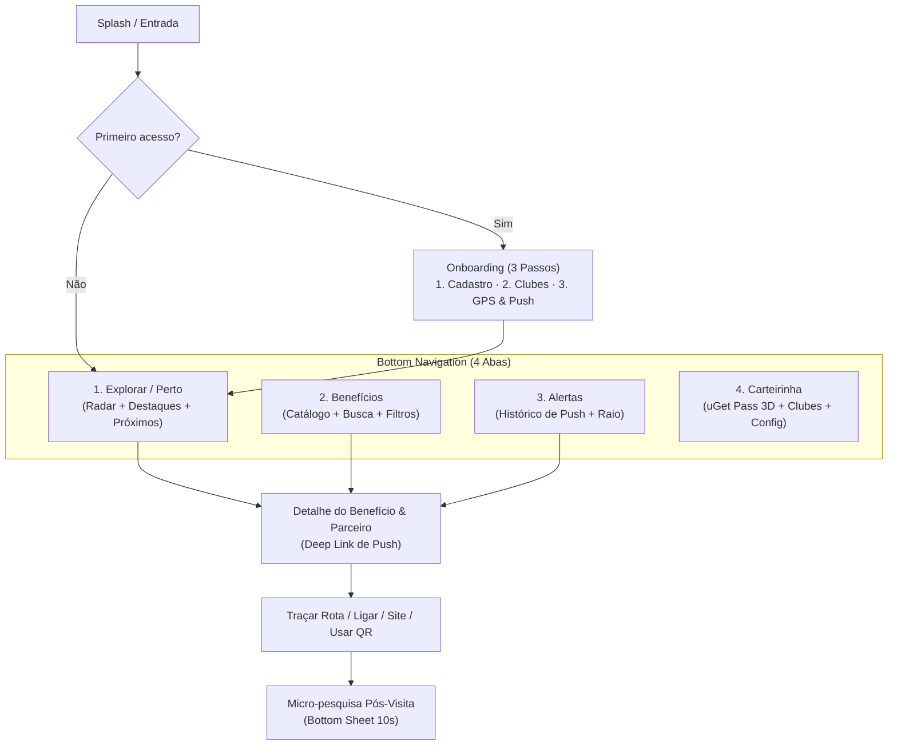
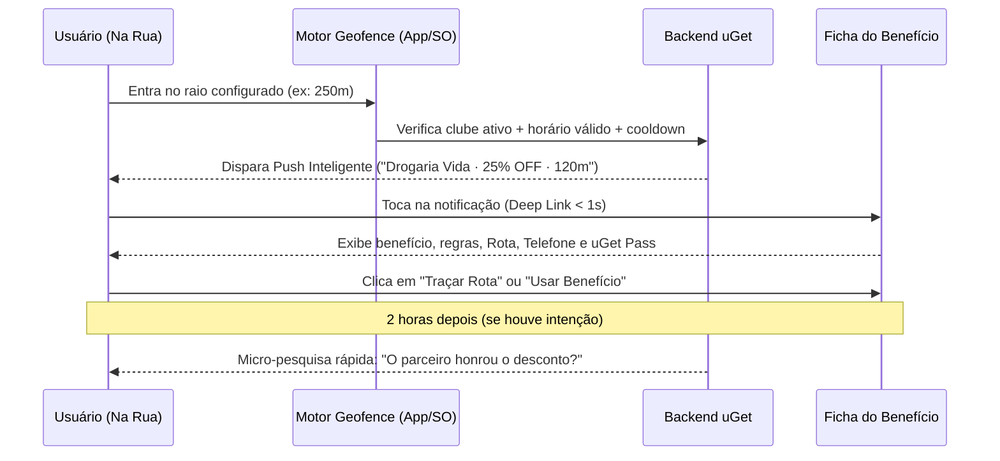

# Especificação de UX (UX Design Specification) — uGet

## 1. Visão & Princípios de Experiência (UX Principles)

O **uGet** é utilizado majoritariamente **em movimento (na rua, no shopping, no intervalo do almoço)** e em momentos rápidos de decisão de compra. Toda decisão de interface deve obedecer a 4 princípios inegociáveis:

1. **Pró-atividade sem Intrusão:** O alerta só aparece quando há valor real imediato (clube ativo + raio configurado + horário válido + fora do cooldown). Nunca parecer spam.
2. **Do Alerta à Ação em ≤ 2 Toques:** Tocar na notificação push abre diretamente a ficha do benefício com as ações principais (*Traçar Rota*, *Ligar*, *Usar Benefício / Carteirinha*) imediatamente acima da dobra.
3. **Legibilidade em Movimento (Clareza Revolut + Marca uGet):** Alto contraste (`#03223A` sobre `#FFFFFF`/`#F4F7FA`), selos de desconto em `uGet Berry (#9B246D)`, distâncias em `JetBrains Mono` (`120m`) e alvos de toque mínimos de `48×48px`.
4. **Controle Transparente de Privacidade:** O usuário enxerga claramente quais clubes estão ativos, qual o raio de busca e pode pausar alertas com 1 toque.

---

## 2. Arquitetura de Informação (Sitemap & Navegação)

### 2.1 App do Usuário (Mobile-First / PWA / iOS & Android)
Navegação principal via **Bottom Tab Bar** fixa (4 itens claros com ícones autorais `ugetds`):

### 2.2 Portal Web B2B (Clubes, Associações & Parceiros — Desktop)
Sidebar lateral fixa com 4 áreas principais no MVP:
1. **Visão Geral (KPIs):** Alertas enviados, taxa de abertura, cliques em rota/telefone e NPS dos convênios.
2. **Benefícios & Convênios:** Criação, edição, vigência, regras e janelas de horário (ex.: almoço/jantar).
3. **Unidades & Geofences:** Mapa interativo para posicionar coordenadas (`lat/lon`) de cada loja/filial.
4. **Avaliações & Auditoria:** Feed de feedbacks pós-visita com alertas automáticos caso algum parceiro não honre o benefício.

---

## 3. Fluxos Críticos de Usuário

### 3.1 Fluxo 1 — Onboarding em < 60 Segundos (`US-01`)
Objetivo: Maximizar a taxa de ativação de GPS e Push (meta ≥ 70%) sem fricção.

1. **Tela de Boas-vindas (Mist `#DCE6EE` + Chevrons 45° + Logo `uGet`):**
   - Headline: *"Nunca mais perca um benefício por não saber que ele estava ao seu lado."*
   - CTA: **Criar conta rápida** (E-mail ou Login Social Google/Apple).
2. **Seleção de Clubes e Instituições (`RF-02`):**
   - Campo de busca instantânea + grid de chips/cards com logos (OAB, ABM, CROBA, Clubes, Programas locais).
   - Seleção múltipla com contador dinâmico no botão inferior: *"Continuar com 2 clubes"*.
3. **Priming Contextual de Permissões (`RF-03`):**
   - Antes do popup nativo do SO, exibe ilustração do **Radar uGet** explicando em 2 linhas:
     - *Localização:* "Só usamos para avisar quando você passar perto de um desconto."
     - *Notificações:* "Alertas limpos, no horário certo e sem spam."
   - Botão primário **Ativar Alertas Inteligentes** → dispara permissões nativas.
   - Link secundário **Agora não (usar só o catálogo)** → garante acesso imediato mesmo sem GPS.

### 3.2 Fluxo 2 — Ciclo do Alerta Inteligente (`US-02` + `US-03`)

---

## 4. Anatomia da Notificação Inteligente (Push Copywriting)

A notificação push é a **principal interface do uGet**. Ela precisa ser compreendida em **menos de 2 segundos** na tela bloqueada:

| Elemento | Regra de UX / Copy | Exemplo Real |
| :--- | :--- | :--- |
| **Título (máx. 42 chars)** | `[Benefício em destaque] · [Nome do Parceiro]` | `25% OFF · Drogaria Vida` |
| **Corpo (máx. 95 chars)** | `[Clube/Convênio] a [Distância] de você. [Gatilho contextual]` | `Seu convênio OAB a 120m. Toque para ver rota e usar no caixa.` |
| **Horário (Gatilho Temporal)** | Restaurantes só notificam em janelas de refeição (`11:15–14:30` / `18:30–22:00`); farmácias/varejo no horário comercial. | Evita push de almoço às 23h |
| **Cooldown Anti-Fadiga** | Máx. 1 alerta por estabelecimento a cada 24h (ou 7 dias se ignorado 2x seguidas). | Previne desinstalação |
| **Ação ao Toque** | Deep link direto para `T03 — Detalhe do Benefício` (nunca abre apenas a home genérica). | Zero fricção |

---

## 5. Especificação Tela a Tela & Mapeamento para `ugetds`

### T01 — Explorar / Perto de Você (Home Principal)
- **Header compacto (Sticky):** Logo `uGet` à esquerda; pílula de status GPS (`● Raio: 500m · Salvador`) clicável para ajuste rápido à direita.
- **Busca Inteligente (`uget-input-wrap`):** Placeholder *"Buscar farmácia, restaurante, convênio..."* + botão inline `Perto` (`data-uget-icon="compass"`).
- **Mini-Radar Interativo (`uget-radar-box` compactado ou toggle Mapa/Lista):** Mostra visualmente quantos benefícios existem no raio atual (ex.: *"4 benefícios a menos de 500m"*).
- **Carrossel "Destaques Próximos" (Scroll horizontal):** Cards `uget-card-navy` (destaque VIP em Deep Navy) e `uget-card` brancos com `uget-flashlight`, exibindo:
  - Badge do Clube (`uget-badge-purple`) + Badge de Desconto (`uget-badge-berry uget-mono`, ex.: `25% OFF`)
  - Nome do Parceiro + Categoria
  - Rodapé com distância (`120m` com `pin-uget`) e status de funcionamento (`Aberto agora`).
- **Chips de Categorias:** Todos, Saúde, Gastronomia, Bem-Estar, Educação, Serviços, Varejo.

### T02 — Catálogo Completo de Benefícios (`RF-10`)
- Lista filtrável de **todos** os benefícios dos clubes do usuário (mesmo fora do raio atual).
- **Barra de Filtros (Bottom Sheet):** Filtrar por Clube/Associação, Categoria, Distância máxima e Ordenação (*Mais próximo*, *Maior desconto*, *Melhor avaliado*).
- **Toggle Lista / Mapa:** Alternância suave entre cards verticais e mapa com pins roxos (`#6B2F8F`) + clusterização.

### T03 — Detalhe do Benefício & Parceiro (`RF-09` — Destino do Deep Link)
- **Topo Visual:** Capa/banner do parceiro (ou gradiente `uget-gradient-navy` com chevrons sutis caso não haja foto) + botão Voltar e Favoritar (`data-uget-icon="heart"`).
- **Bloco Principal (Card elevado `radius: 28px`):**
  - Selo do desconto em destaque (`uget-badge-berry`, ex.: `25% OFF`) + selo do clube (`Convênio OAB`) + nota média (`★ 4.8`).
  - Nome do estabelecimento, endereço completo e distância atual (`120m · 2 min a pé`).
- **Barra de Ações Rápidas (3 botões pill/ícone lado a lado):**
  1. **Traçar Rota** (`compass`) → abre seletor nativo (Google Maps / Waze / Apple Maps).
  2. **Ligar / WhatsApp** → ação direta de contato.
  3. **Site / Redes** → abre link externo.
- **Descrição & Regras Claras:**
  - *O que está incluso* (bullet points escaneáveis).
  - *Como utilizar* (ex.: "Apresente seu uGet Pass no caixa antes do fechamento").
  - *Horários válidos* (ex.: Seg a Sex, 11h30 às 15h).
- **CTA Fixo Inferior (Sticky Bottom Bar):** Botão **1px Shimmer Beam (`uget-btn-beam`)** ou `uget-btn-brand`: **"Usar Benefício (Abrir Carteirinha)"**.

### T04 — Carteirinha Digital `uGet Pass` & Perfil (`US-03` + `US-04`)
- **Cartão Digital 3D (`uget-member-card` com `data-uget-tilt`):**
  - Estética Revolut Metal em Deep Navy + gradiente Purple/Berry + Chevrons 45°.
  - Exibe nome do titular, instituição selecionada, status `ATIVO` e ID/QR Code de validação (toque para ampliar QR com brilho máximo na tela).
- **Seletor de Clubes Ativos:** Lista de associações vinculadas com toggle liga/desliga e botão **+ Adicionar Clube**.
- **Controle de Alertas & Raio (`RF-04` / `RF-07`):**
  - Slider tátil de raio: `250m` · `500m` · `1 km` · `2 km` · `3 km`.
  - Toggle **Modo Não Perturbe** (com opção de agenda: ex. silenciar após 21h).
- **Central de Privacidade & LGPD (`RF-17` / `RNF-08`):**
  - Toggles granulares e independentes de consentimento (*Geolocalização para alertas*, *Notificações Push*, *Micro-pesquisas de qualidade*) exibindo data/hora do consentimento ativo.
  - Botão **Exportar meus dados (JSON)** (portabilidade LGPD) e **Excluir / Anonimizar minha conta** com modal de confirmação dupla explicando de forma clara que os dados pessoais serão anonimizados irreversivelmente.
  - Indicador discreto de saúde do Push (`Notificações Ativas · Dispositivo sincronizado`) com ação de **Reconectar alertas** caso o token do SO/navegador tenha sido revogado.

### T05 — Central de Alertas (`RF-11`)
- Lista cronológica (Hoje / Esta semana) dos alertas de proximidade recebidos, para o usuário resgatar uma oferta mesmo depois de passar pelo local.
- Cada item usa `uget-alert-geo` compacto com badge de distância, horário do alerta e ação direta para `T03`.

### T06 — Micro-pesquisa Pós-Visita (`RF-12` — Bottom Sheet)
- Disparada de forma gentil após uso/resgate (nunca interrompendo uma ação):
  1. *"A Drogaria Vida honrou o benefício de 25% OFF?"* → Botões pill **Sim, tudo certo** / **Tive problema**.
  2. *Avaliação rápida (1 a 5 estrelas)* + campo opcional curto.
  3. Se o usuário marcar **"Tive problema"**, exibe opções rápidas (*Desconto negado*, *Valor diferente*, *Estabelecimento fechado*) e envia alerta automático de auditoria para o Clube gestor no Portal B2B.

---

## 6. Mapeamento Direto para o Design System (`ugetds`)

| Elemento de UX | Classe / Token `ugetds` | Observação de Uso |
| :--- | :--- | :--- |
| **Fundo de Onboarding / Hero** | `--uget-mist (#DCE6EE)` + `.uget-chevron-surface` | Usar chevrons 45° e watermark do Pin `G` |
| **Fundo Geral das Telas** | `--uget-bg-canvas (#F4F7FA)` | Contraste limpo com cards brancos `#FFFFFF` |
| **CTA Principal de Alto Valor** | `.uget-btn-beam` ou `.uget-btn-brand` | Usar apenas 1 por tela (ex.: Ativar Alertas, Usar Benefício) |
| **Ação Secundária / Navegação** | `.uget-btn-navy` / `.uget-btn-soft` / `.uget-btn-outline` | Botões pill `9999px` com micro-scale `0.97` no toque |
| **Card de Benefício Padrão** | `.uget-card.uget-flashlight` | `border-radius: 28px`, padding `24–28px` |
| **Card de Benefício VIP / Destaque** | `.uget-card.uget-card-navy.uget-flashlight.is-dark` | Destaque para maiores descontos ou campanhas |
| **Selo de Desconto (`25% OFF`)** | `.uget-badge.uget-badge-berry.uget-mono` | Sempre em Berry `#9B246D` para escaneabilidade imediata |
| **Selo de Clube / Categoria** | `.uget-badge.uget-badge-purple` | Roxo suave `#F3ECF8` com texto `#4E1F6B` |
| **Carteirinha Digital** | `.uget-member-card` (`data-uget-tilt`) | Inclinação 3D suave no desktop/giroscópio |
| **Notificação Flutuante / Toast** | `UgetDS.geoNotify({...})` (`.uget-geo-toast`) | Fundo Deep Navy com borda Berry translúcida |
| **Ícones** | `[data-uget-icon="..."]` (`ugetds.js`) | Usar os 16 ícones SVG autorais (`pin-uget`, `geo-radar`, `bell-smart`, `qr-redeem`, etc.) |

---

## 7. Estados de Interface (Edge Cases & Resiliência)

| Cenário | Comportamento de UX Esperado |
| :--- | :--- |
| **GPS Recusado ou Desativado** | Banner suave (`.uget-alert-geo`) no topo da Home explicando que os alertas automáticos estão pausados + botão **"Ativar GPS"**; o catálogo completo e a busca por cidade/bairro continuam 100% utilizáveis. |
| **Nenhum Benefício no Raio Atual** | Empty state amigável com ícone `geo-radar`: *"Nenhum parceiro a 250m daqui"* + botão rápido **"Ampliar raio para 1 km"** e lista dos 3 benefícios mais próximos da cidade. |
| **Nenhum Clube Selecionado** | Card de boas-vindas convidando a escolher pelo menos 1 associação/clube para destravar ofertas. |
| **Carregamento (Loading)** | Skeleton screens com bordas arredondadas (`20px–28px`) preservando a geometria exata dos cards (zero layout shift). |
| **Modo Offline (Sem Internet)** | Exibe último catálogo em cache + **Carteirinha `uGet Pass` acessível offline** para não deixar o usuário na mão no caixa! |
| **Token de Push Expirado / Permissão Revogada** | Renovação silenciosa em segundo plano (`RF-18`); caso a permissão tenha sido revogada nas configurações do SO, exibe um banner discreto na aba Alertas com atalho de 1 toque para reativar sem interromper a navegação. |
| **Acesso Restrito / Sessão Expirada (RBAC)** | Redirecionamento seguro para reautenticação silenciosa (refresh token) ou tela de login com aviso claro, sem expor dados sensíveis em tela nem detalhes técnicos de erro. |

---

## 8. Acessibilidade & Motion Responsável

- **Contraste:** Todos os pares texto/fundo do `ugetds` atendem **WCAG 2.1 AA** (≥ 4.5:1). Nunca usar texto cinza claro sobre `#DCE6EE`.
- **Áreas de Toque:** Mínimo de `44×44px` (padrão `48px` nos botões pill `.uget-btn`).
- **Movimento Reduzido:** Todas as animações (`.uget-animate-on-scroll`, `.uget-radar-ring`, `.uget-btn-beam-orbit`, `.uget-marquee-track`) respeitam automaticamente `@media (prefers-reduced-motion: reduce)`.
- **Responsividade:** Mobile-first (`360px–430px` com Bottom Tab Bar) escalando para Tablet/Desktop (`≥ 1024px` com Header fixo + grid de 2–3 colunas no catálogo e layout split no Portal B2B).

---

## 9. Checklist de Prontidão para Prototipagem / Desenvolvimento
- [x] PRD aprovado ([uget_prd.md](./uget_prd.md))
- [x] Design System criado e validado ([ugetds](../ugetds/index.html))
- [x] Arquitetura de informação, fluxos, telas e estados especificados (`uget_ux_spec.md`)
- [ ] Próxima fase (quando autorizado): Protótipo interativo clicável ou implementação do MVP.
